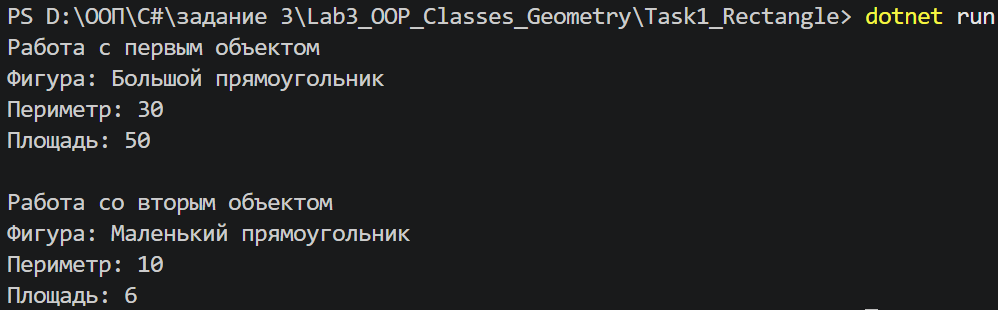
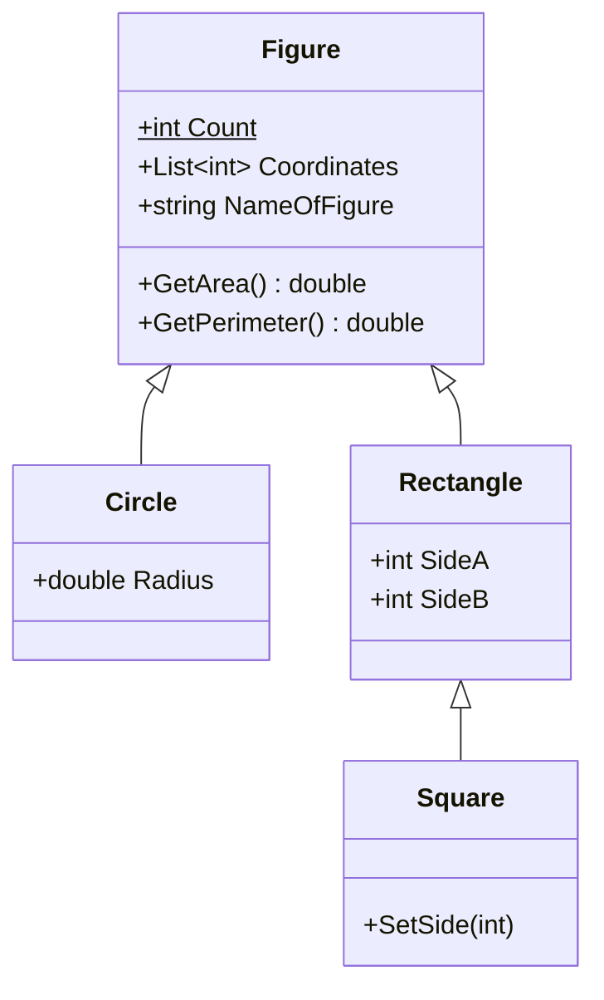

# Лабораторная работа №3 (части 1 и 2): Классы, объекты, конструкторы, деструкторы

> Язык: C# · Платформа: .NET 10 · Тип проектов: консольные приложения
>
> Автор: _ФИО_ · Группа: _номер_ · Курс: _название дисциплины_ · СГУ им. Н. Г. Чернышевского, 2025

Репозиторий содержит проекты на предметной области «геометрические фигуры»:

| Проект | Часть методички | Что в нём |
|---|---|---|
| [`Task1_Rectangle`](Task1_Rectangle) | 1.2 | простой класс `Rectangle`, методы, несколько экземпляров |
| [`Task2_Figures`](Task2_Figures) | 2.2 | иерархия `Figure` → `Circle`, `Rectangle` → `Square`, конструкторы, деструкторы, статическое поле, `List<int>` |

Часть 3 (свойства, инкапсуляция, скрытие членов, совместимость типов) выполнена на другой предметной области и является продолжением и развитием этих заданий: [Lab3_OOP_Classes_Necromancer](https://github.com/Lynastra/Lab3_OOP_Classes_Necromancer).

---

## Проект 1. `Task1_Rectangle` (задание 1.2)

Класс `Rectangle` с полями `SideA`, `SideB`, `Name` и методами `GetPerimeter()`, `GetArea()`, `SetName()`. В `Main` создаются два объекта («Большой» и «Маленький» прямоугольники), для каждого выводятся имя, периметр и площадь.

| Требование | Реализация |
|---|---|
| Пример класса | `Rectangle` |
| Методы | `GetPerimeter()`, `GetArea()`, `SetName()` |
| Несколько экземпляров | `myRectangle1` (5×10), `myRectangle2` (2×3) |



---

## Проект 2. `Task2_Figures` (задание 2.2)

### Архитектура



### Как выполнены требования методички

**1. Родительский класс и классы-наследники.** `Figure` — родитель; `Circle` и `Rectangle` наследуют `Figure`, `Square` наследует `Rectangle`.

**2. Конструкторы по умолчанию и с аргументами.** Есть во всех четырёх классах. Дочерние конструкторы ссылаются:
- на конструктор родителя через `: base(...)` (`Circle`, `Rectangle`, `Square(name, side)`);
- на свой другой конструктор через `: this(...)` (`Rectangle()` → `Rectangle(name, a, b)`, `Square()` → `Square(name, side)`).

**3. Статическое поле.** `Figure.Count` — счётчик созданных фигур. Реализовано как свойство с `private set`: читать его можно извне, а менять только внутри класса.

**4. Поле-экземпляр параметризованного класса.** `Figure.Coordinates` типа `List<int>` (координаты точек подряд: x, y, x, y...). Заполняется методом `AddPoint(x, y)`.

**5. Деструкторы.** Реализованы в каждом классе. В основной версии они написаны так же, как в методичке: `Trace.WriteLine` и метод `GetName()` (см. ниже).

**6. Демонстрационная программа.** Каждый вызов конструктора и деструктора сопровождается сообщением: какой объект и какой конструктор или деструктор вызван.

### Дополнительно: валидация

Сеттеры `Radius`, `SideA`, `SideB` проверяют значение через защищённый метод базового класса `ValidatePositive()`. При значении ≤ 0 выбрасывается `ArgumentException`. В демо это показано на объекте «Плохой круг».

### Деструкторы

В методичке деструктор выводит сообщение через `System.Diagnostics.Trace.WriteLine(...)` и использует метод `GetName()`. Так же сделано в этом проекте. Чтобы сообщения реально появились в консоли, нужно учесть три вещи.

**1. Куда пишет `Trace`.** По умолчанию `Trace.WriteLine` отправляет текст только в окно отладчика (в Visual Studio это окно Output). При запуске через `dotnet run` в консоли ничего не будет. Поэтому в `Main` подключается слушатель вывода в консоль:

```csharp
Trace.Listeners.Add(new ConsoleTraceListener());
```

**2. Кто и когда вызывает деструктор.** Деструктор (финализатор) вызывает сборщик мусора, а не программист, и момент вызова заранее неизвестен. В .NET Framework финализаторы вызывались ещё и при завершении программы, но в .NET 5 и новее при завершении они **не вызываются**. Поэтому сборка мусора запускается явно:

```csharp
GC.Collect();
GC.WaitForPendingFinalizers();
```

`WaitForPendingFinalizers()` заставляет программу дождаться, пока выполнятся все деструкторы, иначе строка «Конец программы» могла бы появиться раньше сообщений.

**3. Объекты должны стать недостижимыми.** Простое обнуление ссылок в `Main` (`obj = null;`) здесь **не сработало**: при проверке на .NET 8 деструкторы не вызвались ни в Debug, ни в Release. Объекты создавались прямо в `Main`, и его локальные переменные и временные значения оставались видимыми для сборщика мусора до конца метода. В документации Microsoft по поводу Debug-сборок сказано, что JIT продлевает время жизни ссылок до конца метода (см. ссылку ниже).

Поэтому создание и использование объектов вынесено в отдельный метод `RunDemo()`. После выхода из него ссылок на объекты не остаётся, и `GC.Collect()` в `Main` вызывает все деструкторы (проверено на .NET 8 в Debug и Release).

Метод помечен атрибутом `[MethodImpl(MethodImplOptions.NoInlining)]`. Согласно документации, `MethodImplOptions.NoInlining` означает «метод нельзя встраить»: JIT-компилятор не будет подставлять тело `RunDemo()` в `Main`. Это страховка: если бы метод был встроен, его локальные переменные снова оказались бы в `Main`. Важно понимать границы: документация описывает только запрет встраивания и ничего не говорит про сборщик мусора и деструкторы, а в проверке на .NET 8 демо работало и без атрибута. Главное здесь — именно отдельный метод, а атрибут исключает встраивание.

### Документация

- [Finalizers (C# programming guide)](https://learn.microsoft.com/dotnet/csharp/programming-guide/classes-and-structs/finalizers): финализаторы вызывает сборщик мусора, их нельзя вызвать напрямую, в .NET 5 и новее они не запускаются при завершении программы.
- [GC.WaitForPendingFinalizers](https://learn.microsoft.com/dotnet/api/system.gc.waitforpendingfinalizers): метод блокирует поток, пока очередь финализаторов не обработана; в примере на странице используются `GC.Collect()` и `GC.WaitForPendingFinalizers()`.
- [ConsoleTraceListener](https://learn.microsoft.com/dotnet/api/system.diagnostics.consoletracelistener): класс, который направляет сообщения `Trace` в консоль.
- [MethodImplOptions (перечисление)](https://learn.microsoft.com/ru-ru/dotnet/api/system.runtime.compilerservices.methodimploptions): описание значения `NoInlining`.
- [MethodImplAttribute (класс)](https://learn.microsoft.com/ru-ru/dotnet/api/system.runtime.compilerservices.methodimplattribute): атрибут, с помощью которого задаются эти параметры; в примере на странице используется `NoInlining`.
- [When GC.KeepAlive Doesn't (блог Microsoft)](https://blogs.msdn.microsoft.com/clyon/when-gc-keepalive-doesnt): в Debug-сборке JIT продлевает время жизни ссылок до конца метода. Это блог разработчика Microsoft, а не справочная страница.

### Что стоит заметить в выводе

- **Порядок конструкторов.** Сначала конструктор родителя, потом наследника: `Figure` → `Rectangle` → `Square`. Для `new Square()` цепочка длиннее: `Square()` вызывает `this(...)`, поэтому сообщение «по умолчанию» выводится **после** сообщений конструктора с аргументами.
- **Порядок деструкторов внутри одного объекта** обратный: `Square` → `Rectangle` → `Figure`.
- **Порядок деструкторов между разными объектами** не определён: его выбирает сборщик мусора, и он может отличаться от запуска к запуску.
- **«Плохой круг».** Исключение возникает после того, как объект создан и конструктор `Figure` уже отработал. Поэтому для такого недостроенного объекта деструкторы всё равно вызываются.

### Известное ограничение

`Square` наследуется от `Rectangle`, как и требует задание, но `SideA` и `SideB` у квадрата можно изменить независимо, и он перестанет быть квадратом. Для учебной задачи это допустимо, в реальном проекте стороны квадрата стоило бы защитить (или не наследовать квадрат от прямоугольника).

### Вывод программы


---

## Как запустить

Нужен [.NET 10 SDK](https://dotnet.microsoft.com/download).

```bash
git clone <ссылка на репозиторий>
cd Lab3_OOP_Classes_Geometry

dotnet run --project Task1_Rectangle
dotnet run --project Task2_Figures
```

## Структура репозитория

```
Lab3_OOP_Classes_Geometry/
├── README.md
├── Task1_Rectangle/
│   ├── Task1_Rectangle.csproj
│   └── Program.cs
├── Task2_Figures/
│   ├── Task2_Figures.csproj
│   └── Program.cs
└── screenshots/
```
